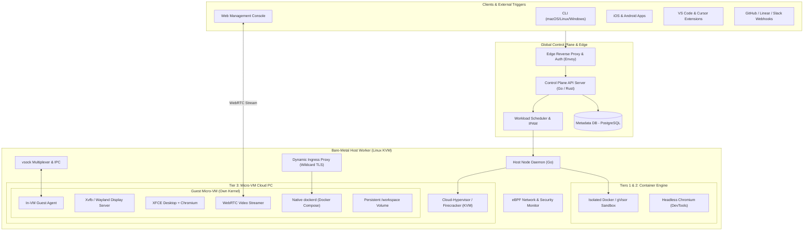

# High-Level System Architecture

## Architecture Overview

The system is organized into three distinct tiers:
1. **Client / Gateway Layer:** Web console, mobile apps (iOS/Android), CLI, IDE extensions (VS Code / Cursor), and third-party webhooks (GitHub, Linear, Slack).
2. **Control Plane & Host Orchestrator:** Global API gateway, session scheduler, bare-metal node manager, eBPF network controllers, and ingress proxies.
3. **Execution Runtime (Dual Engine):**
   - **Tier 1 & 2:** Multi-tenant isolated container pods (Docker / gVisor).
   - **Tier 3 & 4:** Dedicated hardware-isolated micro-VMs (Cloud-Hypervisor / Firecracker over KVM).

---

## Core Components

### 1. Global Control Plane & Edge
* **Edge Proxy (Envoy):** Terminates TLS, validates JWT bearer tokens, and routes traffic between client endpoints and regional bare-metal clusters.
* **API Server:** Built in Go or Rust for high concurrency and minimal footprint. Exposes REST and WebSocket endpoints for workspace lifecycle, agent executions, and real-time logs.
* **Scheduler & IPAM:** Dispatches creation requests to bare-metal worker nodes based on RAM/CPU capacity, GPU availability, and network proximity.

### 2. Bare-Metal Host Worker
* **Bare-Metal Hardware:** High-performance Linux nodes (Ubuntu LTS) with direct access to hardware virtualization extensions (`/dev/kvm`).
* **Host Node Daemon:** Runs as a privileged daemon on each host. Directly interfaces with the hypervisor API (via domain sockets), configures Linux TAP network interfaces, and allocates NVMe storage volumes.
* **vsock Multiplexer:** Bridges the Host API to in-VM Guest Agents over zero-overhead virtual sockets (`virtio-vsock`), avoiding SSH latency and credential overhead.
* **Dynamic Ingress Proxy (Envoy / Caddy):** Dynamically provisions subdomains (e.g. `https://preview-<box_id>-3000.yourdomain.dev`) pointing directly to services running inside the guest VM.

### 3. In-VM Guest Subsystem (Tier 3)
* **Dedicated Linux Kernel:** Stripped-down modern Linux kernel (6.x) with virtio drivers enabled, booting in <300ms.
* **Guest Agent:** Lightweight Go binary running as PID 1 or early systemd service. Listens on `vsock` for commands: command execution (`exec`), file sync, mouse/keyboard inputs, and screenshot capture.
* **Display Server & WebRTC Streamer:** Virtual display (`Xvfb`) running at 1920x1080 resolution. Live frame output is ingested by a WebRTC pipeline to stream 60fps video directly to the user's browser with sub-100ms latency.
* **Native Docker Daemon:** Independent `dockerd` using `overlay2` storage driver. Fully isolated from the host, allowing seamless `docker compose up -d` execution.
