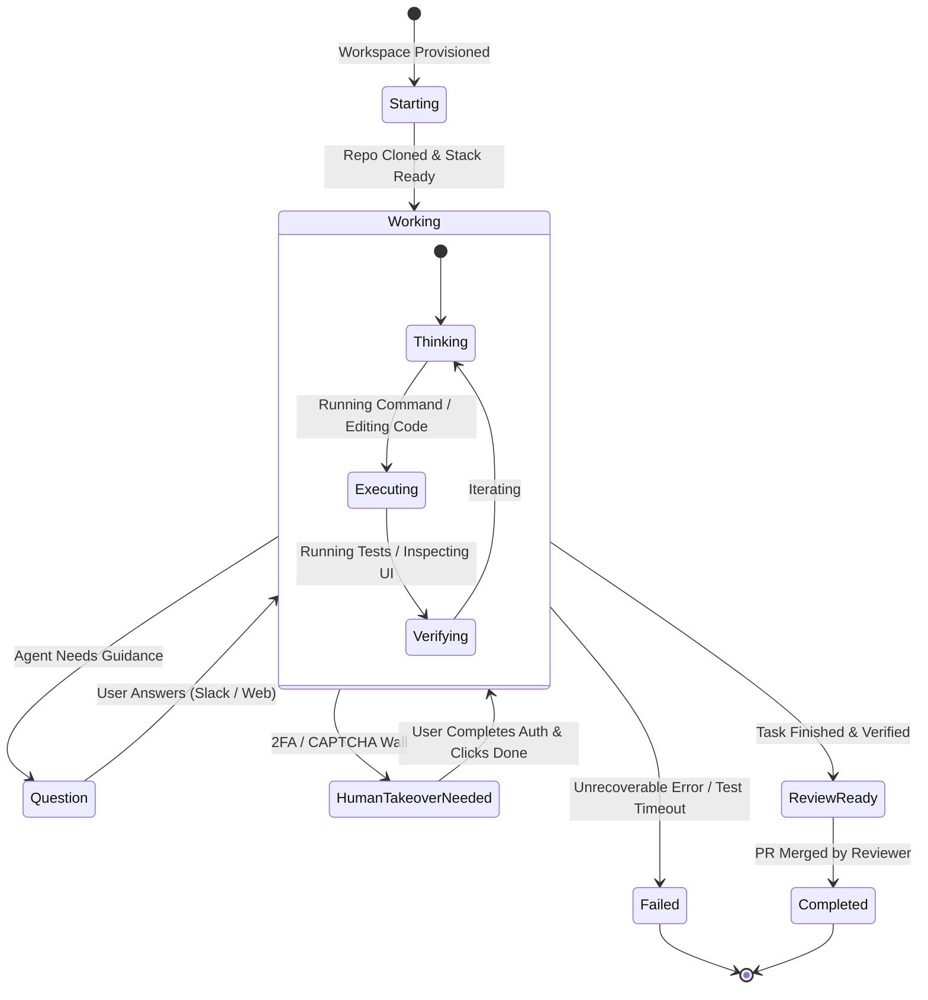

# Agent Notifications, State Machine & Real-Time Fleet Hub

## Overview

Inspired by platforms like **Orca ADE**, **Superset.sh**, and **Conductor.build**, our platform features a unified **Agent Notification & State Machine Subsystem**. When running autonomous coding agents in the cloud, developers should never have to baby-sit a terminal or wonder: *"Is the agent stuck? Is it working? Did it finish?"*

The notification engine keeps developers informed across **Web, Desktop, Slack, Discord, and Mobile**, with bi-directional actionability and zero notification fatigue.

---

## 1. The Core Agent Lifecycle State Machine

Every agent operating within a container or Micro-VM transitions through strict lifecycle states emitted over the host control bus:



### State Definitions & Alert Urgency

| State | Visual Badge | Audio Cue | Push / Slack Alert? | User Action Required |
|---|---|---|---|---|
| `Starting` | ⚪ Grey (Static) | None | ❌ Silent | None |
| `Working` | 🟢 Green (Pulsing) | None | ❌ Silent (Live feed only) | None (Agent executing) |
| `Question` | 🟡 Yellow (Flash) | Chime A | 🔔 **Yes (High Urgency)** | Answer requirement / choice |
| `HumanTakeover` | 🟣 Purple (Pulsing) | Chime B | 🚨 **Yes (Immediate Alert)** | Complete 2FA / solve CAPTCHA |
| `ReviewReady` | 🔵 Blue (Solid) | Success Chime | 🔔 **Yes (High Urgency)** | Review PR & live preview |
| `Completed` | 🟢 Green (Solid) | None | ℹ️ Optional Summary | Task closed |
| `Failed` | 🔴 Red (Solid) | Error Alert | 🚨 **Yes (Immediate Alert)** | Inspect crash logs / revert |

---

## 2. Notification Channels & Bi-Directional Interactivity

### A. Slack & Discord First-Class Bot Integration
The Slack/Discord bot is **fully bi-directional**:
* **Threaded Updates:** When an agent starts a task, a root message is created in the team's `#dev-agents` channel. All subsequent state changes update the message or reply in-thread.
* **Interactive Action Buttons:**
  * **[Approve Command]** / **[Reject]**: For sensitive commands (e.g. `npx prisma migrate`).
  * **[Open Live Screen]**: Generates an ephemeral WebRTC link to take over the desktop.
  * **[Open Live Preview]**: Direct link to the live staging environment.
* **Direct Thread Replies:** When the agent enters the `Question` state (e.g. *"Should I deprecate the v1 endpoint or update it?"*), the developer can simply **reply directly to the Slack/Discord thread**. The bot captures the reply and injects it back into the agent's prompt context over `vsock`.

### B. Web Console & Desktop Native Experience
The Web and Desktop application provide two complementary views:
1. **The Fleet Status Dock (Persistent Sidebar):**
   * Stays docked on the side of the screen regardless of which page the developer is on.
   * Displays all active agent avatars with live pulsing badges, CPU/RAM meters, and a global notification center drawer.
2. **The Agent Kanban Board:**
   * Visual column view: `Backlog` ➔ `Working` ➔ `Blocked / Question` ➔ `Review Ready` ➔ `Merged / Done`.
   * Drag-and-drop prioritization and team-wide agent orchestration.

### C. Webhooks & Event Stream API
* External platforms can subscribe to the raw event stream via secure Webhooks:
  ```json
  {
    "event": "agent.state_changed",
    "timestamp": "2026-10-20T17:52:00Z",
    "workspaceId": "ws_9a8f21c0",
    "agentId": "agent_alpha",
    "previousState": "working",
    "currentState": "question",
    "payload": {
      "question": "Found two existing auth modules: `auth.ts` and `lucia.ts`. Which should I extend?",
      "options": ["Extend auth.ts", "Extend lucia.ts", "Custom"]
    }
  }
  ```

---

## 3. Real-Time Backend Architecture

```
┌─────────────────────────────────────────────────────────────┐
│                 GUEST MICRO-VM / CONTAINER                  │
│   Guest Agent detects state transition                      │
└──────────────────────────────┬──────────────────────────────┘
                               │ virtio-vsock / UNIX Socket
┌──────────────────────────────▼──────────────────────────────┐
│                    HOST NODE SUPERVISOR                     │
│   Publishes state payload to central event mesh             │
└──────────────────────────────┬──────────────────────────────┘
                               │ NATS JetStream / Redis PubSub
┌──────────────────────────────▼──────────────────────────────┐
│               CENTRAL REAL-TIME EVENT BUS (NATS)            │
└──────────────┬──────────────────────────────┬───────────────┘
               │                              │
     ┌─────────▼───────────────┐    ┌─────────▼───────────────┐
     │ WebSocket Gateway Hub   │    │ Outbox Dispatcher       │
     │ - Pushes to Web UI      │    │ - Slack / Discord Bots  │
     │ - Audio chimes triggered│    │ - APNs / FCM Push       │
     │ - Fleet Dock update     │    │ - Retries with backoff  │
     └─────────────────────────┘    └─────────────────────────┘
```

1. **Host-to-Central Event Ingestion:** The in-VM Guest Agent fires a state event across `vsock` to the Host Supervisor, which forwards it to a high-throughput **NATS JetStream / Redis PubSub** cluster.
2. **WebSocket Hub:** Connected browser clients receive the payload in <5ms, updating the status dock and triggering audio chimes.
3. **Outbox Dispatcher:** Handles third-party rate limits (Slack, Discord, Apple Push Notification Service) using an outbox pattern with exponential backoff retries.
